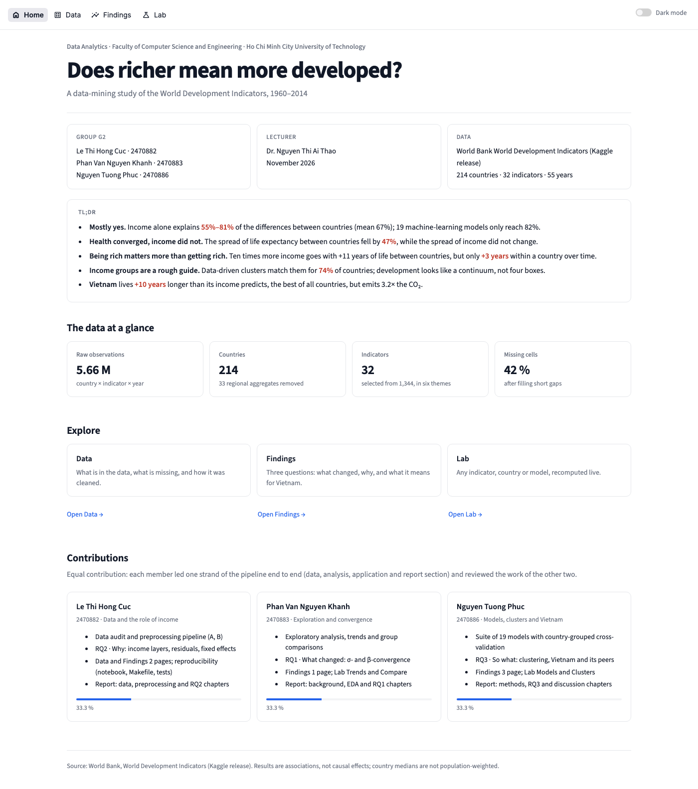
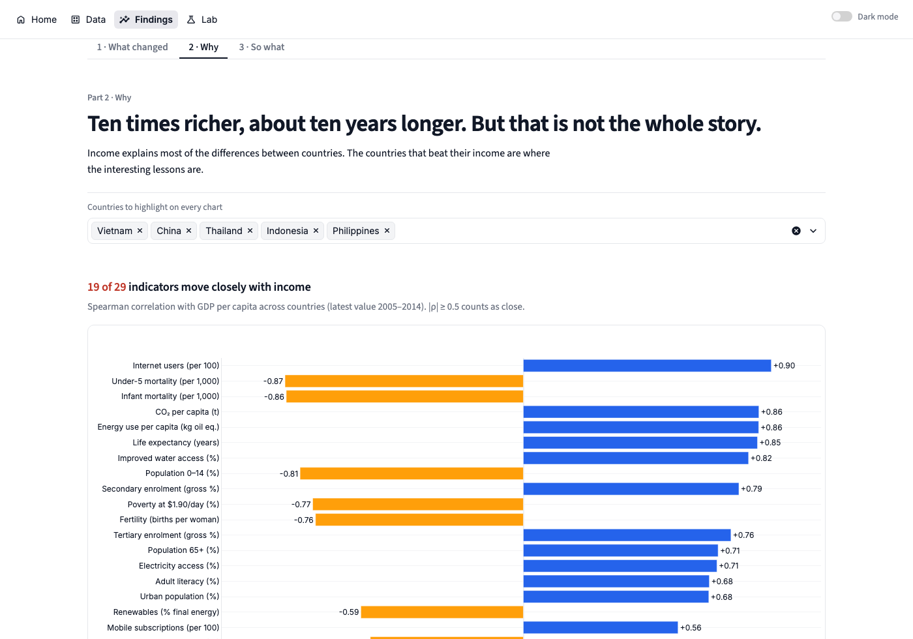
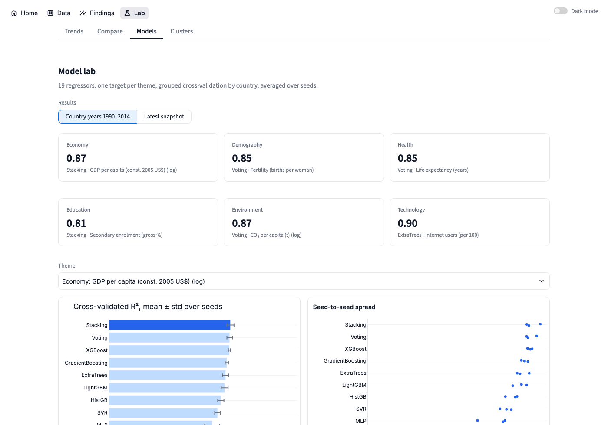

# Does richer mean more developed?

A data-mining study of the World Bank World Development Indicators (WDI), 1960–2014: ETL, missing-data audit,
exploratory analysis, a suite of 19 models, nine experiments and an interactive Streamlit app.

**Live app:** <https://g2-project-assignment.streamlit.app/> · **Report:** [report/FINAL_REPORT.pdf](report/FINAL_REPORT.pdf)

| | |
|---|---|
| Course | Data Analytics, Faculty of Computer Science and Engineering, Ho Chi Minh City University of Technology |
| Lecturer | Dr. Nguyen Thi Ai Thao |
| Group G2 | Le Thi Hong Cuc (2470882) · Phan Van Nguyen Khanh (2470883) · Nguyen Tuong Phuc (2470886) |



## Findings

From 5.66 million WDI observations we kept 32 indicators in six themes for 214 countries. We then asked three
questions: what changed, why, and what it means for Vietnam.

- **Mostly yes.** Log GDP per capita alone explains 55–81 % of the cross-country differences in five development
  themes (mean 67 %). The best of 19 models reaches 82 %.
- **Health converged, income did not.** The spread of life expectancy between countries fell by 47 % from 1960 to
  2013. The spread of income did not shrink.
- **Being rich matters more than getting rich.** Ten times more income goes with about +11 years of life expectancy
  between countries, but only about +3 years within a country over time.
- **Income groups are a rough guide.** Data-driven clusters match the World Bank income groups for 74 % of
  countries.
- **Vietnam** lives about 10 years longer than its income predicts, the largest gap of 203 countries. It also emits
  3.2 times the CO₂ its income predicts.

## App

| Page | Tabs |
|---|---|
| Home | title, group, TL;DR, key numbers, contributions |
| Data | A · Exploration · B · Preprocessing |
| Findings | 1 · What changed · 2 · Why · 3 · So what |
| Lab | Trends · Compare · Models · Clusters, recomputed live |

Every tab has its own link, for example <https://g2-project-assignment.streamlit.app/findings?tab=why>. The light
and dark modes are switched with the toggle at the top right.

| | |
|---|---|
|  |  |
| **2 · Why**: income-only fit, residual scorecard, fixed effects | **Models**: 19 models, multi-seed R², live experiments |

## Quick start

Requires Python 3.11 or later and `make`.

```bash
make app        # create .venv, install requirements, open the app at http://localhost:8501
make all        # rebuild everything from the raw data: setup, download, notebook, tests (~40 min)
```

The app runs on the bundled `app_data/` and `results/`, so the raw data is not needed to start it. `make data`
downloads the three Kaggle files used (`Country.csv`, `Series.csv`, `Indicators.csv`) into `data/raw/`. No account
is needed. `make notebook` executes `WDI_Analysis.ipynb` end to end and `make test` runs the checks.

The notebook sections can also be run from the command line:

```bash
.venv/bin/python run_models.py --mode snapshot --seeds 0 1 2 3 4    # model suite, snapshot
.venv/bin/python run_models.py --mode panel --seeds 0 1 2           # model suite, panel (~30 min)
.venv/bin/python -m wdi.story                                       # A1-A3, B, E1.1-E3.3 -> results/story/
.venv/bin/python run_story.py --part 2                              # Why tab -> results/story/part2/
```

## Repository

| Path | Content |
|---|---|
| `WDI_Analysis.ipynb` | end-to-end notebook: download, ETL, exploration, trends, comparisons, model suite, experiments |
| `app.py`, `ui/` | Streamlit app: `core.py` (design system, data, navigation), `sections.py` (pages and tabs), one module per page |
| `wdi/models.py` | model suite with country-grouped cross-validation |
| `wdi/story/` | data checks (`explore.py`) and experiments by research question (`part1.py`, `part2.py`, `part3.py`) |
| `run_models.py`, `run_story.py` | command-line runners |
| `app_data/` | compressed processed tables (panel 11,935 × 32, snapshot 214 × 32) |
| `results/`, `figures/` | result tables and charts |
| `report/` | LaTeX source and PDF of the final report |
| `tests/` | pipeline, headline-number and app checks |
| `Makefile` | `setup`, `data`, `notebook`, `test`, `app`, `all` |

## Model suite

Each theme has one target, explained by the other indicators. Near-definitional indicators are excluded; for
example, infant mortality is excluded when the target is life expectancy.

| Theme | Target |
|---|---|
| Economy | GDP per capita (log) |
| Demography | fertility |
| Health | life expectancy |
| Education | secondary enrolment |
| Environment | CO₂ per capita (log) |
| Technology | internet users |

**Models:** Linear, Ridge, Lasso, ElasticNet, BayesianRidge, Huber, KNN, SVR, DecisionTree, RandomForest, ExtraTrees,
GradientBoosting, HistGB, AdaBoost, MLP, XGBoost, LightGBM, Voting and Stacking.

**Evaluation:** K-fold cross-validation grouped by country, so a country is never in both the training and the test
fold. It is repeated over several seeds and reported as mean ± std of R², MAE and RMSE.

| Option | Values |
|---|---|
| `--mode` | `snapshot` (latest value per country) or `panel` (country-years 1990–2014) |
| `--seeds`, `--folds` | e.g. `--seeds 0 1 2 --folds 5` |
| `--impute` | `median`, `knn` or `iterative` |
| `--min-coverage` | drop sparse features |
| `--models`, `--themes` | subsets |
| `--no-year` | panel only: drop Year as a feature |

## Contributions

Each member led one strand end to end and reviewed the other two (33.3 % each).

| Member | Strand |
|---|---|
| Le Thi Hong Cuc | data audit and preprocessing; RQ2 · Why (income layers, residuals, fixed effects); reproducibility |
| Phan Van Nguyen Khanh | exploratory analysis, trends and comparisons; RQ1 · What changed (convergence) |
| Nguyen Tuong Phuc | model suite; RQ3 · So what (clustering, Vietnam and its peers) |

## Data

World Bank, *World Development Indicators*, Kaggle release
<https://www.kaggle.com/datasets/kaggle/world-development-indicators>. The raw files are not committed (`data/` is
ignored); the notebook regenerates `data/processed/`.
