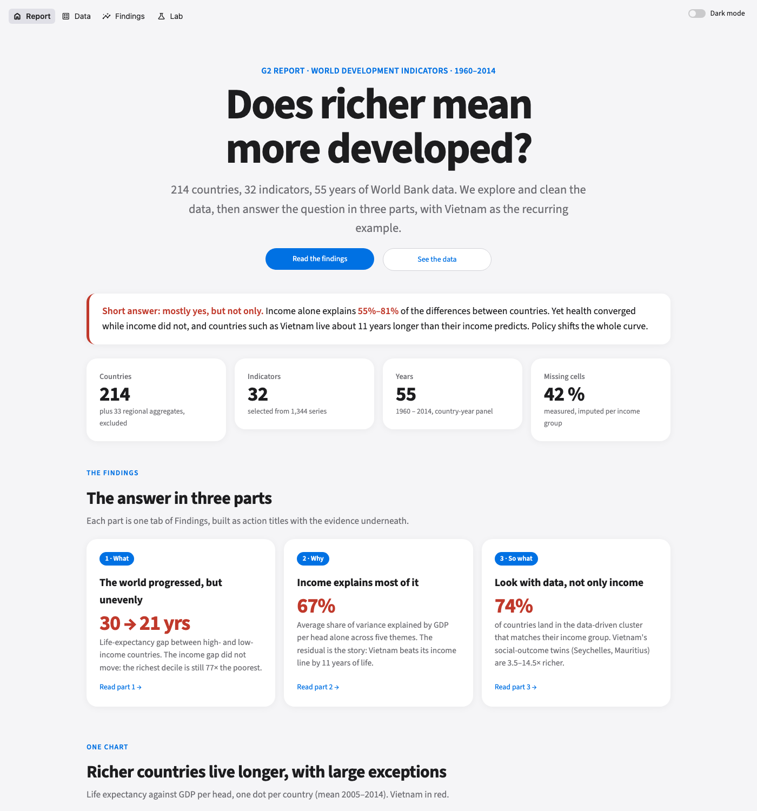
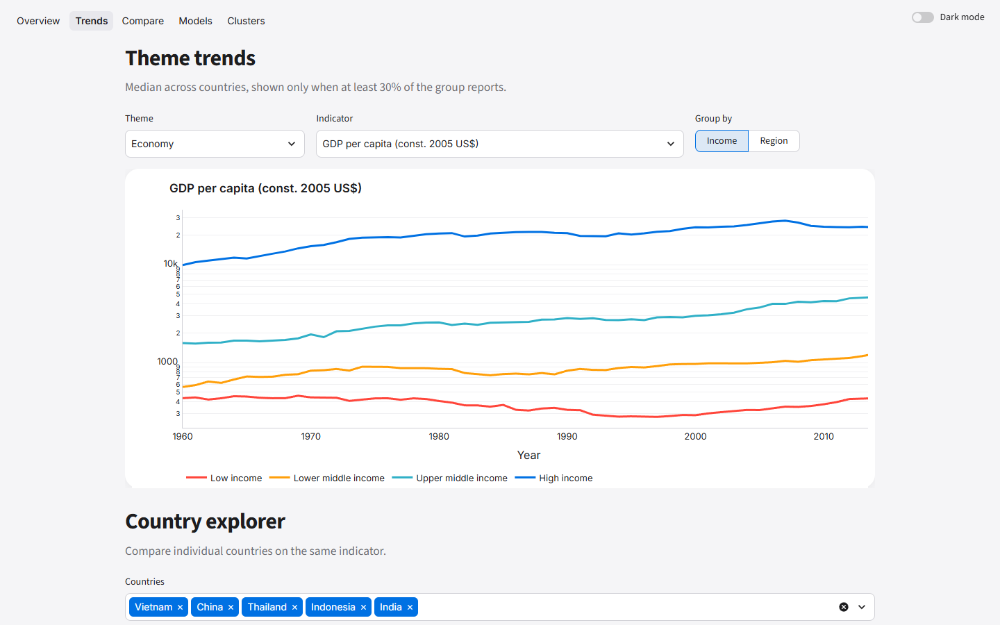
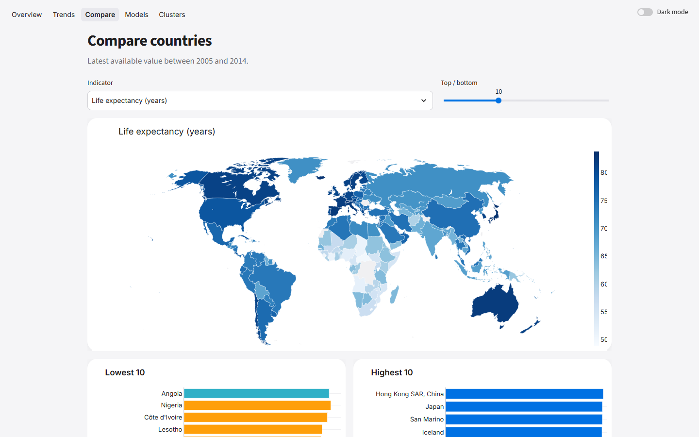
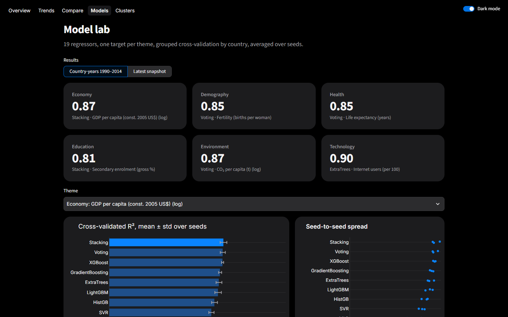
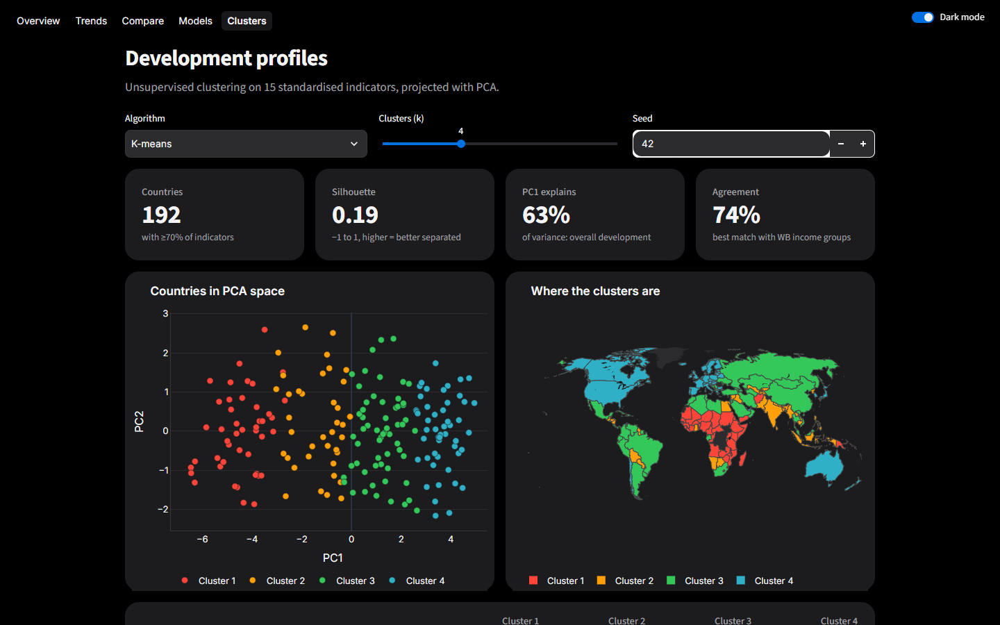
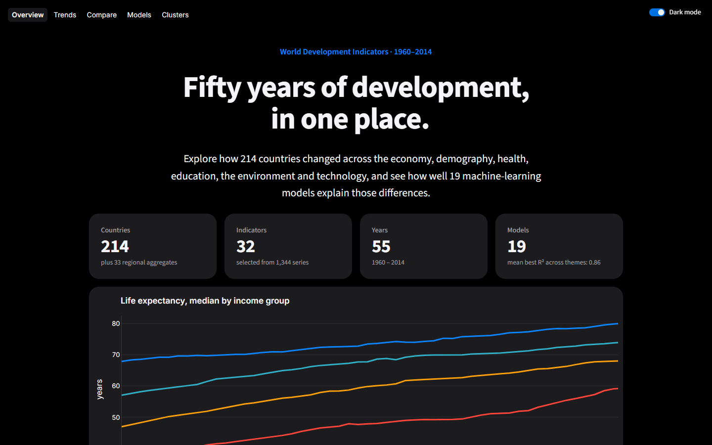

# G2 Project Assignment: World Development Indicators analysis

End-to-end data-analytics project on the World Bank **World Development Indicators** (Kaggle `kaggle/world-development-indicators`, 1960–2015). It covers ETL, missing-data handling, EDA, theme trends, cross-country comparison, a multi-model evaluation suite, and an interactive Streamlit app.



| | |
|---|---|
|  |  |
| **Trends**: every indicator by income group or region | **Compare**: map, rankings, any-two-indicator scatter |
|  |  |
| **Models**: 19 models, multi-seed R², live experiments | **Clusters**: K-means / GMM / Ward with your own k and seed |

<p align="center"><br><em>Light and dark mode, switchable from the top-right toggle.</em></p>

| File | Content |
|---|---|
| `WDI_Analysis.ipynb` | Main notebook, executed, with commentary in every section (writes `data/processed/`) |
| `REPORT.md` | Short written report with the key findings |
| `wdi/models.py` | Model suite: 19 regressors × 6 themes × N seeds, grouped CV, importance, trend predictions |
| `run_models.py` | CLI for the model suite, writes `results/` |
| `wdi/story/` | Experiments by section: `explore.py` (A exploration, B preprocessing checks), `part1.py` / `part2.py` / `part3.py` (storyline E1–E3), `common.py` |
| `app.py` | Streamlit entry point: four top-level pages, **Home** (title, group, TL;DR) · **Data** (tabs A Exploration, B Preprocessing) · **Findings** (tabs 1 What, 2 Why, 3 So what) · **Lab** (tabs Trends, Compare, Models, Clusters); tabs are shareable links such as `/findings?tab=why`; light/dark toggle top-right |
| `ui/` | One module per page group: `core.py` (design system, data, story helpers, tab navigation), `sections.py` (which tabs each parent page has), `landing.py` (Report), `data.py` (A, B), `part1.py`, `part2.py`, `part3.py`, `explore.py` (Lab tabs) |
| `report/` | LaTeX final report, its tables (`make_tables.py`) and PDF |
| `tests/` | `test_models.py`, `test_story.py` (A/B checks + E1–E3), `test_part2.py`, `test_app.py` (the landing page and every tab, light and dark) |
| `figures/` | Charts exported by the notebook |
| `results/` | Precomputed model results used by the app |
| `app_data/` | Gzipped processed data (1.5 MB) so the app runs without the raw Kaggle files |
| `data/` | Raw Kaggle CSVs and processed files (not committed, regenerate below) |

## Reproduce
```bash
python -m venv .venv
.venv/Scripts/pip install -r requirements.txt        # Linux/macOS: .venv/bin/pip
# 1. data + notebook (needs a Kaggle API token in ~/.kaggle/kaggle.json)
.venv/Scripts/kaggle datasets download -d kaggle/world-development-indicators --unzip -p data/raw
.venv/Scripts/jupyter nbconvert --to notebook --execute --inplace WDI_Analysis.ipynb
# 2. model suite
.venv/Scripts/python run_models.py --mode snapshot --seeds 0 1 2 3 4
.venv/Scripts/python run_models.py --mode panel                      # slower, ~1 h on a laptop
.venv/Scripts/python tests/test_models.py
.venv/Scripts/python run_story.py --part 2                          # Part 2 page experiments -> results/story/part2/ (~5 s)
.venv/Scripts/python tests/test_part2.py
.venv/Scripts/python -m wdi.story                                  # A1-A3, B, E1.1-E3.3 -> results/story/, figures/story/
.venv/Scripts/python tests/test_story.py
.venv/Scripts/python report/make_tables.py                          # LaTeX tables for report/FINAL_REPORT.tex
# 3. app
.venv/Scripts/python tests/test_app.py                             # landing page and every tab render, light and dark (~1 min)
.venv/Scripts/streamlit run app.py
```
Only `Country.csv`, `Series.csv` and `Indicators.csv` are used; `database.sqlite` (1.4 GB) can be deleted.

## Model suite
Each theme gets one target that the other indicators try to explain:

| Theme | Target |
|---|---|
| Economy | GDP per capita (log) |
| Demography | fertility |
| Health | life expectancy |
| Education | secondary enrolment |
| Environment | CO₂ per capita (log) |
| Technology | internet users |

Near-definitional indicators are excluded as features. For example, infant and under-5 mortality are excluded when the target is life expectancy.

**Models:** Linear, Ridge, Lasso, ElasticNet, BayesianRidge, Huber, KNN, SVR, DecisionTree, RandomForest, ExtraTrees, GradientBoosting, HistGB, AdaBoost, MLP, XGBoost, LightGBM, Voting and Stacking.

**Evaluation:** grouped K-fold by country (a country is never in both train and test). It is repeated over several seeds and reported as mean ± std of R², MAE and RMSE.

| Option | Values |
|---|---|
| `--mode` | `snapshot` (latest value per country) / `panel` (country-years 1990–2014, more rows) |
| `--seeds` | any list, e.g. `0 1 2 42` |
| `--folds` | CV folds |
| `--impute` | `median` / `knn` / `iterative` |
| `--min-coverage` | drop sparse features |
| `--models`, `--themes` | subsets |
| `--no-year` | panel only: drop Year as a feature |

## Deploy (free)
**Streamlit Community Cloud:** push the repo to GitHub, open share.streamlit.io, choose the repo and set `app.py` as the entry point. The app reads `app_data/` and `results/`, so the raw data is not needed. The maps load Plotly's world shapes from its CDN.
