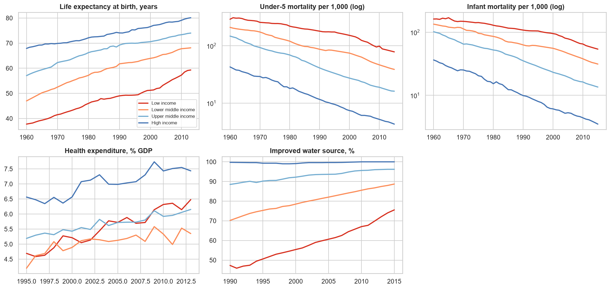
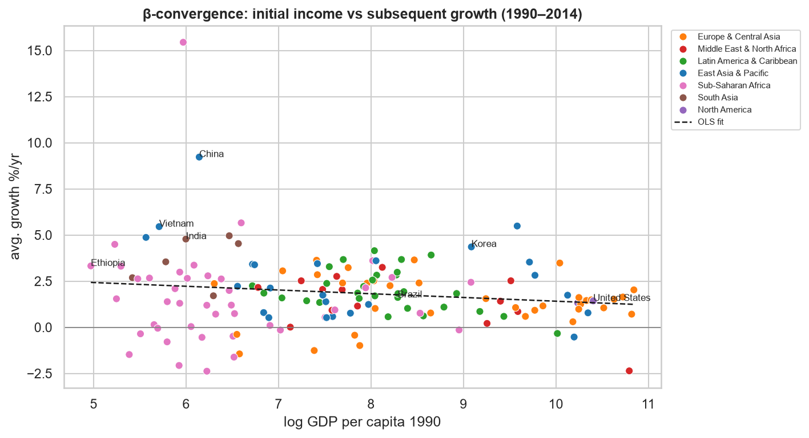
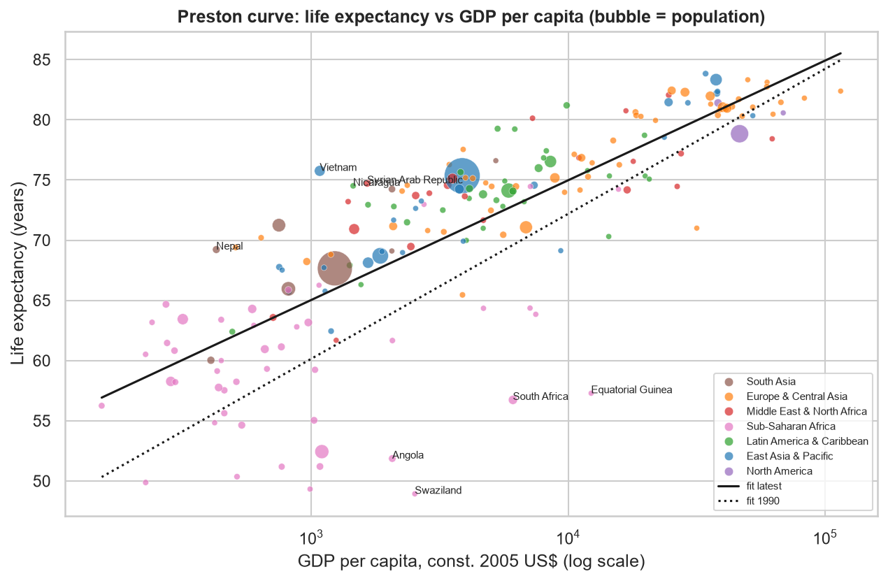
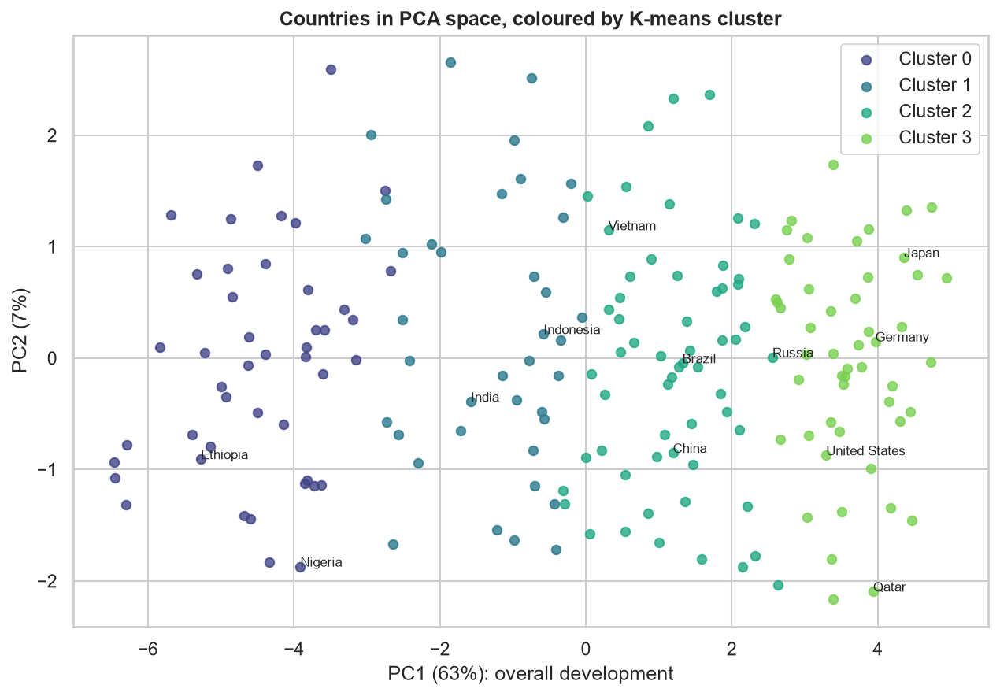

# World Development Indicators, 1960–2014: Project Report

**Data:** World Bank WDI via Kaggle (`kaggle/world-development-indicators`): 5.66 M observations, 247 economies/aggregates, 1,344 indicators, 1960–2015.
**Full analysis:** [`WDI_Analysis.ipynb`](WDI_Analysis.ipynb) (all code, tables and charts; figures are also in [`figures/`](figures)).

## 1. Objective
We analyse how countries developed over 1960–2014 across six themes: economy, demography, health, education, environment, and technology. The questions are how countries compare today, which indicators move together, and whether data-driven country groups match the World Bank income classification.

## 2. Method

**ETL.**
* *Extract:* the 574 MB `Indicators.csv` was read in chunks and filtered to 32 selected indicators, keeping 247 k rows in about 35 MB of memory.
* *Transform:* the 214 countries were separated from 33 aggregates (World, Euro area, ...). We validated duplicates, non-finite values and domain ranges (none found). We flagged, but kept, 29 hyperinflation country-years.
* *Reshape:* long → wide country-year panel, plus a cross-country snapshot holding the latest value in 2005–2014.

**Missing data.** 45 % of panel cells are empty, mostly *structurally* (series that start in 1990 or are survey-based). We therefore:
* interpolated only short gaps inside a series (≤ 3 years, no extrapolation);
* used the latest value in a 10-year window for the snapshot;
* imputed income-group medians only for models;
* excluded indicators with < 60 % coverage from models (only poverty at $1.90);
* plotted group trends only when ≥ 30 % of a group's countries reported.

**Analysis.**
* Group-median trends by income group and region.
* Rankings, and between-country inequality (Gini, p90/p10).
* β-convergence regression.
* Spearman correlations.
* Preston curve and environmental Kuznets curve.
* Life-expectancy prediction (linear vs random forest, 5-fold CV).
* K-means clustering with silhouette selection and PCA.

## 3. Key findings

**1. Broad social progress, led by health.** Life expectancy rose in every region, by up to +30 years in South Asia (39 → 69). The gap between high- and low-income countries fell from 30.1 to 20.8 years. Primary enrolment became near-universal, and mobile subscriptions reached about 64 per 100 people even in low-income countries.

**2. Income did not converge.** Middle-income countries grew faster than rich ones over 1990–2014 (median GDP per capita growth of 2.1 and 1.7 %/yr vs 0.6 %/yr). Still, cross-country income inequality barely moved: the Gini was 0.70 → 0.67 and the p90/p10 ratio went from 77× to 81×. The β-convergence slope is negative but weak (r = −0.16, p = 0.05). Catch-up came from specific countries: China (9.2 %/yr), Vietnam (5.5 %), Lao PDR and India. In contrast, education, electricity and mobile access *did* converge.

**3. Sub-Saharan Africa is the main outlier in the demographic transition.** Fertility fell 60–67 % in South Asia, MENA, East Asia and Latin America, but only 28 % in Sub-Saharan Africa (6.7 → 4.8). All 10 poorest countries and all 10 shortest-lived populations are in the region.

**4. Income explains most, but not all, of health.** Each 10× rise in GDP per capita goes with about +10 years of life expectancy (R² = 0.65). The curve shifted up about 5 years at a given income since 1990. Vietnam (+10.4 years above prediction), Nepal, Nicaragua and Bangladesh over-perform. HIV-affected Southern Africa and oil economies (Equatorial Guinea, Angola) under-perform by 15–20 years.

**5. Model evaluation.** In cross-validation, log GDP alone predicts life expectancy with R² 0.64 (MAE 3.6 years). Adding water, electricity, schooling, fertility, urbanisation, health spending and female labour participation raises this to R² 0.76 (MAE 2.9 years). A random forest does no better (R² 0.76, MAE 2.8), so the relationship is essentially linear in log income, and the interpretable linear model is preferred.

**6. Growth still means more CO₂.** CO₂ per capita correlates with income as tightly as life expectancy does (ρ = 0.86 vs 0.85). The cross-sectional Kuznets turning point is about US$51,000 per head, and only 9 of 192 countries are above it. Only 26 of 56 high-income countries cut per-capita CO₂ between 1990 and 2011. World forest cover fell from 31.8 % to 30.8 % of land (1990–2012).

**7. Development is largely one-dimensional, and income groups miss part of it.** One principal component explains 63 % of the variance across 15 indicators. Four K-means clusters (low development / transition / emerging / advanced) match World Bank income groups for 74 % of countries. The mismatches are informative: oil-rich Equatorial Guinea and Angola fall into the low-development cluster. Vietnam, which the World Bank classified as lower-middle income, groups with China, Thailand and Malaysia as "emerging".

## 4. Case study: Vietnam
Real GDP per capita rose 4.1× (1984–2014). Life expectancy (75.8) equals that of China and Thailand, which are about 3.5× richer, and exceeds Indonesia, the Philippines and India by 7–8 years. Fertility is below replacement (1.74), internet use matches China (48 per 100), and forest cover is high (47 %). The remaining gaps are the income level itself and child mortality (22 per 1,000 vs 7–13 in Malaysia, China and Thailand).

## 5. Limitations
* The Kaggle extract ends in 2014–2015 (CO₂ in 2011) and uses the old income groups and 2005 prices.
* Missingness is not random: poorer countries report less.
* All relationships are cross-sectional associations, not causal effects.
* Country medians weight Tuvalu like China (a "typical country" view, not a "typical person" view).
* CO₂ is territorial and ignores trade.

**Next steps:** refresh from the live WDI API to cover the 2020s, run fixed-effects panel models for within-country effects, and add population-weighted inequality and consumption-based CO₂.
